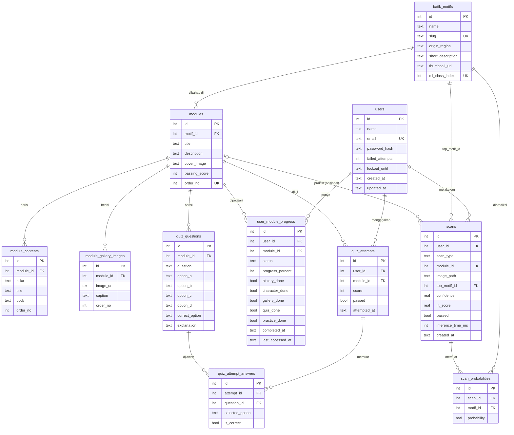

# Kenali Batikmu — Backend

REST API untuk aplikasi **Kenali Batikmu**: modul belajar batik, kuis teori, dan scan motif batik (kuis praktik).

| | |
|---|---|
| Bahasa / framework | Python 3.10+, Flask 3 |
| Database | SQLite (SQL murni via sqlite3, tanpa ORM) |
| Autentikasi | JWT (HS256) + hash password scrypt |
| Dependensi | `Flask`, `PyJWT`, `python-dotenv` |

Dokumen ini menjelaskan **struktur database SQLite**, **struktur backend**, dan **panduan integrasi dengan aplikasi Flutter Mobile** (`Kenali-Batikmu-Mobile`). Cara menjalankan ada di bagian akhir.

---

## Daftar Isi

1. [Struktur Folder](#1-struktur-folder)
2. [Struktur Database](#2-struktur-database)
3. [Struktur Backend](#3-struktur-backend)
4. [Daftar Endpoint](#4-daftar-endpoint)
5. [Aturan Bisnis](#5-aturan-bisnis)
6. [Konfigurasi](#6-konfigurasi)
7. [Menjalankan & Menguji](#7-menjalankan--menguji)
8. [Catatan & Keterbatasan](#8-catatan--keterbatasan)

---

## 1. Struktur Folder

```
kenali_batikmu_backend/
├── run.py                  # Entry point server pengembangan
├── manage.py               # CLI database: init-db | seed [--demo] | reset --yes
├── requirements.txt
├── .env.example            # Contoh variabel environment
├── .gitignore
├── app/
│   ├── __init__.py         # create_app(): konfigurasi, init DB, seed, blueprint, CORS
│   ├── config.py           # Kelas Config (dibaca dari environment / .env)
│   ├── db.py               # Koneksi SQLite per-request + init_db()
│   ├── schema.sqlite.sql   # DDL seluruh tabel + indeks (SQLite)
│   ├── security.py         # Hash password, JWT, decorator @auth_required, util waktu
│   ├── errors.py           # ApiError + format error JSON seragam
│   ├── seed.py             # Data awal: motif, modul, materi, galeri, soal, akun demo
│   ├── routes/             # Lapisan HTTP (Flask Blueprint)
│   │   ├── auth.py         #   /api/auth/*
│   │   ├── motifs.py       #   /api/motifs/*
│   │   ├── modules.py      #   /api/modules/* (materi, progres pilar, kuis teori)
│   │   ├── scans.py        #   /api/scans/*, /api/modules/{id}/practice
│   │   └── profile.py      #   /api/profile
│   └── services/           # Logika bisnis yang dipakai oleh routes
│       ├── progress.py     #   Perhitungan progres modul
│       ├── ml.py           #   Antarmuka klasifikasi motif (Classifier + StubClassifier)
│       └── uploads.py      #   Validasi & penyimpanan gambar upload
├── tests/
│   └── test_api.py         # 35 tes (unittest)
├── docs/
│   └── DATABASE.md         # Perbandingan ERD awal vs skema yang dipakai
└── uploads/                # Folder gambar hasil scan (isi tidak masuk git)
```

---

## 2. Struktur Database

Skema lengkap ada di [`app/schema.sqlite.sql`](app/schema.sqlite.sql). Total **12 tabel** (skema versi 2).

### 2.1 Ringkasan

| Kelompok | Tabel | Fungsi |
|---|---|---|
| Pengguna | `users` | Akun pengguna (nama, email, nomor HP) + data penguncian login |
| | `password_resets` | OTP lupa kata sandi (hanya HMAC-nya yang disimpan) |
| Katalog | `batik_motifs` | Daftar motif batik + indeks kelas model ML |
| Pembelajaran | `modules` | Modul belajar (setiap modul membahas satu motif) |
| | `module_contents` | Materi teks per pilar (sejarah, karakteristik, galeri) |
| | `module_gallery_images` | Gambar galeri tiap modul |
| | `quiz_questions` | Soal pilihan ganda tiap modul |
| Progres & kuis | `user_module_progress` | Progres belajar satu pengguna pada satu modul |
| | `quiz_attempts` | Satu kali pengerjaan kuis teori |
| | `quiz_attempt_answers` | Jawaban per soal dalam satu percobaan |
| Scan | `scans` | Satu kali scan (universal atau kuis praktik) |
| | `scan_probabilities` | Probabilitas tiap motif pada satu scan |

### 2.2 Diagram Relasi (ERD)



### 2.3 Kamus Data

Tipe bool disimpan sebagai `INTEGER` 0/1. Semua waktu disimpan sebagai teks **ISO-8601 UTC**, contoh `2026-10-10T05:30:00Z`.

#### `users`
| Kolom | Tipe | Keterangan |
|---|---|---|
| `id` | INTEGER PK | Auto increment |
| `name` | TEXT | Nama lengkap (maks. 100 karakter, divalidasi di API) |
| `email` | TEXT UNIQUE | `COLLATE NOCASE`, jadi tidak peka huruf besar/kecil |
| `phone` | TEXT NULL | Nomor HP (diubah lewat `PATCH /api/profile`) |
| `password_hash` | TEXT | Format `scrypt$N$r$p$salt_b64$hash_b64` |
| `failed_attempts` | INTEGER | Jumlah login gagal berturut-turut (default 0) |
| `lockout_until` | TEXT NULL | Akun terkunci sampai waktu ini |
| `created_at`, `updated_at` | TEXT | Waktu dibuat / diubah |

#### `batik_motifs`
| Kolom | Tipe | Keterangan |
|---|---|---|
| `id` | INTEGER PK | |
| `name` | TEXT | Nama motif, mis. "Parang Kusumo" |
| `slug` | TEXT UNIQUE | mis. `parang-kusumo` |
| `origin_region` | TEXT | Daerah asal |
| `short_description` | TEXT | Deskripsi singkat |
| `thumbnail_url` | TEXT NULL | Path/URL gambar |
| `ml_class_index` | INTEGER UNIQUE, `>= 0` | Posisi motif pada keluaran model ML (lihat [§5.5](#55-klasifikasi-motif-ml)) |

#### `modules`
| Kolom | Tipe | Keterangan |
|---|---|---|
| `id` | INTEGER PK | |
| `motif_id` | INTEGER FK → `batik_motifs.id` | Motif yang dibahas (satu motif boleh punya banyak modul) |
| `title`, `description` | TEXT | Judul dan deskripsi modul |
| `cover_image` | TEXT NULL | Path **aset yang ada di app** (`assets/images/...`) atau `NULL` (app menampilkan ikon) |
| `video_url` | TEXT NULL | Link video YouTube materi |
| `passing_score` | INTEGER, 0–100 | Nilai minimal lulus (default **70**) |
| `order_no` | INTEGER UNIQUE | Urutan tampil |

#### `module_contents`
| Kolom | Tipe | Keterangan |
|---|---|---|
| `module_id` | FK → `modules.id` (CASCADE) | |
| `pillar` | TEXT | `sejarah_filosofi` \| `karakteristik` \| `galeri` |
| `title`, `body` | TEXT | Judul dan isi materi |
| `badge` | TEXT NULL | Label kecil pada kartu karakteristik (mis. "Struktur Utama") |
| `order_no` | INTEGER | `UNIQUE (module_id, pillar, order_no)` |

Konvensi `order_no` (dibaca app mobile untuk menempatkan teks pada layar yang sama):

| Pilar | `order_no` | Tampil sebagai |
|---|---|---|
| `sejarah_filosofi` | 1 / 2 / 3 / 4 | Hakikat & Simbol / Asal Daerah & Sejarah / Makna Filosofis / Penggunaan & Pakem |
| `karakteristik` | 1 | Paragraf ringkasan |
| | 2 / 3 / 4 | Kartu Struktur Utama / Ornamen / Warna (memakai `badge`) |
| | 5, 6, … | Daftar pakem bernomor |

Bagian yang tidak diisi tidak ditampilkan app. Baris pilar `galeri` tidak dipakai app (galeri dibaca dari `module_gallery_images`).

#### `module_gallery_images`
| Kolom | Tipe | Keterangan |
|---|---|---|
| `module_id` | FK → `modules.id` (CASCADE) | |
| `image_url` | TEXT NULL | Path gambar; `NULL` = hanya keterangan (app menampilkan ikon) |
| `caption` | TEXT NULL | Keterangan |
| `order_no` | INTEGER | `UNIQUE (module_id, order_no)` |

#### `quiz_questions`
| Kolom | Tipe | Keterangan |
|---|---|---|
| `module_id` | FK → `modules.id` (CASCADE) | |
| `question` | TEXT | Pertanyaan |
| `option_a` … `option_d` | TEXT | Empat pilihan jawaban |
| `correct_option` | TEXT | `A` \| `B` \| `C` \| `D` |
| `explanation` | TEXT NULL | Penjelasan jawaban benar |

#### `user_module_progress`
Satu baris per pasangan pengguna–modul (`UNIQUE (user_id, module_id)`). Baris dibuat saat pengguna pertama kali membuka modul.

| Kolom | Tipe | Keterangan |
|---|---|---|
| `user_id`, `module_id` | FK (CASCADE) | |
| `status` | TEXT | `not_started` \| `in_progress` \| `completed` |
| `progress_percent` | INTEGER, 0–100 | Kelipatan 20 |
| `history_done` | bool | Pilar sejarah & filosofi selesai |
| `character_done` | bool | Pilar karakteristik selesai |
| `gallery_done` | bool | Pilar galeri selesai |
| `quiz_done` | bool | Lulus kuis teori |
| `practice_done` | bool | Lulus kuis praktik |
| `completed_at` | TEXT NULL | Waktu pertama kali mencapai 100% |
| `last_accessed_at` | TEXT | Waktu terakhir modul dibuka/dikerjakan |

#### `quiz_attempts`
| Kolom | Tipe | Keterangan |
|---|---|---|
| `user_id`, `module_id` | FK (CASCADE) | |
| `score` | INTEGER, 0–100 | |
| `passed` | bool | `score >= modules.passing_score` |
| `attempted_at` | TEXT | |

#### `quiz_attempt_answers`
| Kolom | Tipe | Keterangan |
|---|---|---|
| `attempt_id` | FK → `quiz_attempts.id` (CASCADE) | |
| `question_id` | FK → `quiz_questions.id` (CASCADE) | `UNIQUE (attempt_id, question_id)` |
| `selected_option` | TEXT | `A` \| `B` \| `C` \| `D` |
| `is_correct` | bool | |

#### `scans`
| Kolom | Tipe | Keterangan |
|---|---|---|
| `user_id` | FK → `users.id` (CASCADE) | Pemilik scan |
| `scan_type` | TEXT | `universal` (scan bebas) \| `kuismu` (kuis praktik pada modul) |
| `module_id` | FK → `modules.id`, NULL | Wajib terisi bila `scan_type = 'kuismu'` |
| `image_path` | TEXT NULL | Nama file di folder `uploads/` |
| `top_motif_id` | FK → `batik_motifs.id` | Motif dengan probabilitas tertinggi |
| `confidence` | REAL, 0–1 | Probabilitas motif teratas |
| `fit_score` | REAL, 0–1, NULL | Probabilitas motif target modul (hanya `kuismu`) |
| `passed` | bool NULL | Hasil kuis praktik; `NULL` untuk scan universal |
| `inference_time_ms` | INTEGER | Lama inferensi |
| `created_at` | TEXT | |

Constraint tambahan: `CHECK (scan_type = 'universal' OR module_id IS NOT NULL)`.

#### `scan_probabilities`
| Kolom | Tipe | Keterangan |
|---|---|---|
| `scan_id` | FK → `scans.id` (CASCADE) | |
| `motif_id` | FK → `batik_motifs.id` | `UNIQUE (scan_id, motif_id)` |
| `probability` | REAL, 0–1 | Satu baris per motif untuk setiap scan |

#### `password_resets`
| Kolom | Tipe | Keterangan |
|---|---|---|
| `user_id` | FK → `users.id` (CASCADE) | |
| `otp_hash` | TEXT | HMAC-SHA256(SECRET_KEY, `user_id:otp`); OTP 4 digit tidak disimpan polos |
| `attempts` | INTEGER | Salah OTP; terkunci setelah `OTP_MAX_ATTEMPTS` (5) |
| `verified` | 0/1 | 1 setelah OTP benar |
| `reset_token_hash` | TEXT NULL | HMAC token sekali pakai untuk `reset-password` |
| `expires_at` | TEXT | OTP: 5 menit; setelah verifikasi: 10 menit |
| `used_at`, `created_at` | TEXT | |

### 2.4 Integritas Data

- **Foreign key aktif**: `PRAGMA foreign_keys = ON` dipasang di setiap koneksi (`app/db.py`).
- **`ON DELETE CASCADE`**: menghapus `users`, `modules`, `quiz_attempts`, atau `scans` ikut menghapus data anaknya.
- **`CHECK` constraint** untuk semua enum (`pillar`, `status`, `scan_type`, opsi jawaban) dan rentang nilai (persen 0–100, probabilitas 0–1).
- **Indeks** untuk query yang sering dipakai:

  | Indeks | Kolom |
  |---|---|
  | `idx_modules_motif` | `modules (motif_id)` |
  | `idx_contents_module` | `module_contents (module_id, pillar, order_no)` |
  | `idx_questions_module` | `quiz_questions (module_id)` |
  | `idx_attempts_user_module` | `quiz_attempts (user_id, module_id, attempted_at)` |
  | `idx_scans_user` | `scans (user_id, created_at)` |
  | `idx_scanprob_scan` | `scan_probabilities (scan_id)` |

- **Mode WAL** diaktifkan saat `init_db()`.
- `init_db()` memakai `CREATE TABLE IF NOT EXISTS`, jadi aman dijalankan berulang kali. Tidak ada sistem migrasi.

### 2.5 Data Awal (seed)

Diisi otomatis oleh `db.seed_db()` dari [`app/seed.sqlite.sql`](app/seed.sqlite.sql) bila tabel `batik_motifs` masih kosong:

| Data | Jumlah | Catatan |
|---|---|---|
| Motif | 20 | `ml_class_index` 0–19 **identik dengan urutan & nama kelas** di `app/models/labels.txt` (dijaga oleh test `test_motifs_match_ml_labels_exactly`) |
| Modul | 20 | Satu per motif, `id` = `order_no`, `passing_score` 70 |
| Materi | 93 baris | Modul 6 (Kawung), 8 (Mega Mendung), 9 (Parang) dan 18 (Truntum) berisi materi lengkap dari aplikasi; 16 modul lain 1 paragraf per pilar |
| Soal kuis | 84 | 4 per modul; modul 9 punya 8 (termasuk 4 soal Parang Kusumo dari app) |

Tidak ada user atau percobaan kuis dalam seed. Akun demo untuk pengembangan (`sekar@batikmu.id` / `Batikmu123#` dan `kenalibatikmu@gmail.com` / `kenalibatikmupbl`) dibuat bila `SEED_DEMO_USERS=1` atau `python manage.py seed-demo`. **Matikan di produksi** (password-nya publik).

Database lama (skema v1) dimigrasi otomatis saat start (kolom `phone`, `video_url`, `badge`), tetapi datanya tidak ikut berubah; untuk memuat data terbaru jalankan `python manage.py reset --yes` (menghapus semua data).

> Perbandingan skema ini dengan ERD awal ada di [`docs/DATABASE.md`](docs/DATABASE.md).

---

## 3. Struktur Backend

### 3.1 Arsitektur

Backend memakai pola berlapis sederhana:

```
Klien (Flutter)
     │  HTTP + JSON  (Authorization: Bearer <JWT>)
     ▼
┌──────────────────────────────────────────────┐
│ routes/        Blueprint: validasi request,  │
│                panggil service, bentuk JSON  │
├──────────────────────────────────────────────┤
│ services/      Logika bisnis (progres,       │
│                klasifikasi ML, upload gambar)│
├──────────────────────────────────────────────┤
│ security.py    Hash password, JWT, auth      │
│ errors.py      ApiError → JSON seragam       │
├──────────────────────────────────────────────┤
│ db.py          sqlite3 (SQL murni)           │
└──────────────────────────────────────────────┘
     │                          │
     ▼                          ▼
 kenali_batikmu.db          uploads/ (gambar scan)
```

### 3.2 Application Factory (`app/__init__.py`)

`create_app()` dijalankan sekali saat server start dan melakukan urutan berikut:

1. Memuat `Config` (dan override `test_config` bila ada, dipakai oleh tes).
2. Membuat folder `UPLOAD_DIR` bila belum ada.
3. Menjalankan `init_db()` untuk membuat tabel.
4. Bila `AUTO_SEED=1`, mengisi data referensi jika database kosong.
5. Mendaftarkan penutup koneksi DB (`teardown_appcontext`) dan penangan error.
6. Mendaftarkan 5 blueprint: `auth`, `motifs`, `modules`, `scans`, `profile`.
7. Menambahkan `GET /api/health` dan header CORS (hanya untuk origin yang terdaftar di `CORS_ORIGINS`).

### 3.3 Modul `app/`

| File | Tanggung jawab |
|---|---|
| `config.py` | Kelas `Config`. Semua nilai dibaca dari environment/`.env`. Bila `SECRET_KEY` belum diisi, kunci acak sementara dibuat dan peringatan dicatat di log |
| `db.py` | `connect()` membuat koneksi dengan `row_factory = sqlite3.Row` dan foreign key aktif. `get_db()` menyimpan satu koneksi per request di `flask.g`, `close_db()` menutupnya. `init_db()` menjalankan `schema.sqlite.sql` |
| `security.py` | `hash_password` / `verify_password` (scrypt, salt acak 16 byte, N=2¹⁴, r=8, p=1), `create_token` (JWT HS256, klaim `sub`, `iat`, `exp`), dekorator `@auth_required` yang menyimpan pengguna di `g.user`, serta util waktu UTC (`now_iso`, `parse_iso`, …) |
| `errors.py` | `ApiError(status, code, message, **extra)` dan penangan untuk `ApiError`, 413, `HTTPException`, serta `Exception` tak terduga (500) |
| `seed.py` | `seed_demo_users()` untuk akun demo pengembangan (data referensi ada di `seed.sqlite.sql`) |

**Format error** selalu seragam:

```json
{ "error": { "code": "validation_error", "message": "Format email tidak valid", "field": "email" } }
```

### 3.4 Routes (`app/routes/`)

| File | Blueprint (prefix) | Isi |
|---|---|---|
| `auth.py` | `/api/auth` | Register, login (dengan penguncian akun), data pengguna saat ini |
| `motifs.py` | `/api/motifs` | Daftar & detail motif (detail menyertakan modul terkait) |
| `modules.py` | `/api/modules` | Daftar modul + progres, detail modul, tandai pilar selesai, soal kuis, kirim jawaban, riwayat percobaan |
| `scans.py` | `/api` | Scan universal, kuis praktik per modul, riwayat scan, detail scan, gambar scan |
| `profile.py` | `/api/profile` | Profil + statistik belajar |

Semua endpoint kecuali `register`, `login`, dan `health` dilindungi `@auth_required`.

### 3.5 Services (`app/services/`)

**`progress.py`** — logika progres modul
- `mark_done(db, user_id, module_id, kolom)`: menandai satu komponen selesai, menghitung ulang `progress_percent` dan `status`, mengisi `completed_at` saat pertama kali 100%. Nama kolom divalidasi dengan whitelist (`COMPONENTS`) karena disisipkan ke SQL.
- `touch(...)`: memperbarui `last_accessed_at`.
- `get_progress`, `empty_progress`, `serialize`: bentuk JSON progres.

**`ml.py`** — klasifikasi motif
- `Classifier` adalah `Protocol` dengan satu method: `predict(image_bytes, class_count) -> list[float]`.
- `StubClassifier` (bawaan) menghasilkan probabilitas pseudo-acak yang stabil untuk gambar yang sama. **Ini hanya placeholder**, bukan model sungguhan.
- `get_classifier()` mengambil `app.config["CLASSIFIER"]` bila ada, jika tidak memakai `StubClassifier`.

**`uploads.py`** — gambar upload
- `read_image_upload()` membaca field multipart `image`, mendeteksi tipe lewat **magic bytes** (JPEG, PNG, WebP), tidak mempercayai `Content-Type` dari klien.
- `save_image()` menyimpan dengan nama acak `uuid4().hex.<ext>`; `delete_image()` membersihkan bila penyimpanan ke DB gagal.

### 3.6 Alur Request Penting

**Kuis teori** — `POST /api/modules/{id}/quiz/attempts`
1. Validasi body `answers` (soal harus milik modul, opsi A–D, tidak boleh duplikat).
2. Soal yang tidak dijawab dihitung salah; penilaian dilakukan di server.
3. Dalam satu transaksi: insert `quiz_attempts` + `quiz_attempt_answers`; bila lulus, `mark_done(..., "quiz_done")`.
4. Respons berisi skor, kunci jawaban + penjelasan, dan progres terbaru.

**Scan universal** — `POST /api/scans/universal`
1. Validasi & baca gambar → jalankan klasifikasi untuk semua motif.
2. Simpan file ke `uploads/`, lalu insert `scans` + `scan_probabilities` (satu baris per motif) dalam satu transaksi. Bila gagal, file dihapus.
3. Respons: motif teratas, saran modul, dan **top-5**.

**Kuis praktik** — `POST /api/modules/{id}/practice`
1. Alur sama seperti scan universal, tetapi `scan_type = 'kuismu'`.
2. `fit_score` = probabilitas motif milik modul; lulus bila `fit_score >= passing_score / 100`.
3. Bila lulus, `practice_done` ditandai.

---

## 4. Daftar Endpoint

Semua kecuali `register`, `login`, `forgot-password`, `verify-otp`, `reset-password`, dan `health` memerlukan header `Authorization: Bearer <token>`.

| Method | Path | Fungsi |
|---|---|---|
| GET | `/api/health` | Cek server |
| POST | `/api/auth/register` | `{name, email, password}` → 201 `{user, token}`; 409 bila email sudah dipakai |
| POST | `/api/auth/login` | `{email, password, remember_me?}` → `{user, token}`; 401 salah, 423 akun terkunci |
| GET | `/api/auth/me` | Pengguna saat ini |
| POST | `/api/auth/forgot-password` | `{email}` → buat OTP 4 digit & kirim lewat SMTP. 404 `email_not_found`, 429 `otp_throttled`. Tanpa SMTP: `delivery:"demo"` + `demo_otp` (hanya bila `ALLOW_DEMO_OTP=1`) |
| POST | `/api/auth/verify-otp` | `{email, otp}` → `{reset_token}`; 422 `invalid_otp` (+`attempts_left`), `otp_expired`; 429 `otp_locked` |
| POST | `/api/auth/reset-password` | `{email, reset_token, new_password}` → 200; token sekali pakai |
| GET | `/api/motifs` | Daftar motif |
| GET | `/api/motifs/{id}` | Detail motif + modul terkait |
| GET | `/api/modules` | Daftar modul + progres pengguna |
| GET | `/api/modules/{id}` | Detail: materi per pilar, galeri, motif, progres (mencatat `last_accessed_at`) |
| POST | `/api/modules/{id}/pillars/{history\|character\|gallery}` | Tandai pilar selesai |
| GET | `/api/modules/{id}/quiz` | Soal kuis (tanpa kunci jawaban) |
| POST | `/api/modules/{id}/quiz/attempts` | `{answers:[{question_id, selected_option}]}` → skor, lulus, kunci + penjelasan |
| GET | `/api/modules/{id}/quiz/attempts` | Riwayat percobaan + skor terbaik |
| POST | `/api/modules/{id}/practice` | Upload `image` (multipart) → penilaian kuis praktik |
| POST | `/api/scans/universal` | Upload `image` (multipart) → top-5 motif |
| GET | `/api/scans?type=&limit=&offset=` | Riwayat scan (`limit` 1–100, default 50) |
| GET | `/api/scans/{id}` | Detail scan + ranking seluruh motif (hanya pemilik) |
| GET | `/api/scans/{id}/image` | Gambar scan (hanya pemilik) |
| GET | `/api/profile` | Profil + statistik belajar |
| PATCH | `/api/profile` | `{name?, email?, phone?, password?}`; `password:""` = tidak diubah; 409 `email_taken` |

Contoh:

```bash
TOKEN=$(curl -s -X POST localhost:8000/api/auth/login \
  -H 'Content-Type: application/json' \
  -d '{"email":"sekar@batikmu.id","password":"Batikmu123#"}' \
  | python -c "import sys,json;print(json.load(sys.stdin)['token'])")

curl -H "Authorization: Bearer $TOKEN" localhost:8000/api/modules
curl -H "Authorization: Bearer $TOKEN" -F image=@kain.jpg localhost:8000/api/scans/universal
```

---

## 5. Aturan Bisnis

### 5.1 Autentikasi
- Kata sandi: minimal 8 karakter, maksimal 128. Email divalidasi dan disimpan huruf kecil.
- Token JWT berlaku **24 jam**; bila `remember_me` bernilai `true` (default) berlaku **30 hari**. Klaim `exp` wajib ada.
- **Penguncian akun**: setelah **5** kali gagal login, akun terkunci **15 menit** (HTTP 423 + `retry_after_seconds`). Login berhasil mereset hitungan.
- Email yang tidak terdaftar tetap menjalankan hash tiruan agar waktu respons tidak membocorkan keberadaan akun.

### 5.2 Progres modul
```
progress_percent = 20 × jumlah komponen selesai
komponen = history_done, character_done, gallery_done, quiz_done, practice_done
status   = completed (100) | in_progress (> 0) | not_started (0)
```
Sebuah komponen yang sudah `true` tidak bisa kembali `false`.

### 5.3 Kuis teori
```
score  = round(jumlah_benar × 100 / jumlah_soal_modul)
lulus  = score >= modules.passing_score        (default 70)
```

### 5.4 Kuis praktik & scan

| Jenis | Skor yang dinilai | Lulus | `module_id` / `fit_score` / `passed` |
|---|---|---|---|
| Praktik (`kuismu`) | `fit_score` = probabilitas motif milik modul | `fit_score >= passing_score / 100` | terisi |
| Universal | `confidence` = probabilitas motif teratas | tidak dinilai | `NULL` |

Label penilaian praktik: `≥ 0.70` → `sangat_mirip`, `0.50–0.69` → `cukup_mirip`, `< 0.50` → `perlu_dilatih`.

Pada riwayat scan, scan universal mendapat `passed` turunan (`confidence >= 0.70`) yang **tidak disimpan** di database.

### 5.5 Klasifikasi motif (ML)
- `batik_motifs.ml_class_index` harus berurutan **0 … N-1** tanpa lompatan. Bila tidak, API mengembalikan error `model_mismatch`.
- Keluaran `predict()` harus berupa list berisi tepat N angka yang terbatas (finite); nilai dipotong ke rentang 0–1.
- Untuk memasang model sungguhan, buat kelas dengan method `predict(image_bytes, class_count) -> list[float]`, lalu set `app.config["CLASSIFIER"]`.

### 5.6 Upload gambar
- Format: JPEG, PNG, WebP (dicek dari magic bytes). Format lain → 415.
- Batas ukuran default **8 MB** (413 bila terlampaui).
- Nama file acak. Gambar scan hanya bisa diakses pemiliknya (pengguna lain mendapat 404).

---

## 6. Konfigurasi

Salin `.env.example` menjadi `.env`. Semua variabel opsional kecuali `SECRET_KEY` untuk produksi.

| Variabel | Default | Keterangan |
|---|---|---|
| `DATABASE` | `app/kenali_batikmu.db` | Path ke file database SQLite |
| `SECRET_KEY` | acak sementara | **Wajib di produksi.** Tanpanya semua token tidak valid setelah restart |
| `UPLOAD_DIR` | `./uploads` | Folder gambar scan |
| `MAX_UPLOAD_MB` | `16` | Batas ukuran upload (foto kamera HP bisa > 8 MB) |
| `TOKEN_TTL_HOURS` | `24` | Masa berlaku token login biasa |
| `TOKEN_TTL_REMEMBER_DAYS` | `30` | Masa berlaku token "ingat saya" |
| `MAX_FAILED_ATTEMPTS` | `5` | Batas login gagal sebelum terkunci |
| `LOCKOUT_MINUTES` | `15` | Lama penguncian |
| `CORS_ORIGINS` | kosong (nonaktif) | Daftar origin dipisah koma, hanya perlu untuk Flutter Web |
| `AUTO_SEED` | `1` | Isi data referensi otomatis bila database kosong |
| `SEED_DEMO_USERS` | `0` | `1` = buat 2 akun demo (password publik; jangan di produksi) |
| `ALLOW_DEMO_OTP` | `0` | `1` = tanpa SMTP, OTP dikembalikan di respons API (mode demo). **Wajib 0 di produksi** |
| `SMTP_HOST`, `SMTP_PORT`, `SMTP_SECURITY`, `SMTP_USER`, `SMTP_PASSWORD`, `SMTP_FROM` | kosong | Pengiriman email OTP (`SMTP_SECURITY`: `starttls` \| `ssl` \| `none`) |
| `OTP_TTL_MINUTES`, `OTP_MAX_ATTEMPTS`, `OTP_RESEND_SECONDS`, `RESET_TOKEN_TTL_MINUTES` | `5`, `5`, `30`, `10` | Aturan OTP |
| `HOST` / `PORT` | `127.0.0.1` / `8000` | Alamat server pengembangan |

Buat `SECRET_KEY`:

```bash
python -c "import secrets;print(secrets.token_urlsafe(48))"
```

---

## 7. Menjalankan & Menguji

### 7.1 Backend (Flask + SQLite)

1. Pasang environment dan dependensi:
   ```bash
   python -m venv .venv && source .venv/bin/activate    # Windows: .venv\Scripts\activate
   pip install -r requirements.txt
   cp .env.example .env                                  # sesuaikan SECRET_KEY
   ```
2. Inisialisasi dan seed database:
   ```bash
   python manage.py init-db
   python manage.py seed                                 # isi data referensi
   ```
3. Jalankan backend:
   ```bash
   python run.py                                         # http://127.0.0.1:8000
   ```

Database SQLite (`kenali_batikmu.db`) akan dibuat otomatis di folder `app/`.

Perintah `manage.py`:

| Perintah | Fungsi |
|---|---|
| `python manage.py init-db` | Buat seluruh tabel SQLite dari `schema.sqlite.sql` |
| `python manage.py seed` | Isi data referensi jika tabel motif masih kosong |
| `python manage.py reset --yes` | **Hapus** file database SQLite, buat ulang, lalu seed |

### 7.2 Aplikasi Mobile (Flutter)

Aplikasi mobile (`../Kenali-Batikmu-Mobile`) kini memakai backend ini sebagai satu-satunya sumber data
(akun, modul, materi, kuis, scan, profil). Alamat server:

- **Android Emulator**: `http://10.0.2.2:8000` (otomatis)
- **Windows / Web / macOS / iOS Simulator**: `http://127.0.0.1:8000` (otomatis)
- **HP fisik**: jalankan backend dengan `HOST=0.0.0.0`, lalu
  `flutter run --dart-define=API_BASE_URL=http://192.168.x.x:8000`

Tampilan, tema, dan navigasi app tidak diubah. Detail integrasi: `../CATATAN_PERUBAHAN.md`.

Tes:

```bash
python -m pytest -q tests      # atau: python -m unittest discover -s tests -v
```

Produksi: jalankan di belakang HTTPS (reverse proxy) dengan server WSGI, misalnya
`pip install gunicorn && gunicorn "app:create_app()"`.

---

## 8. Catatan & Keterbatasan

1. **Model ML**: `app/models/batik_mobilenetv2.tflite` (20 kelas) dijalankan lewat `ai-edge-litert`, `tflite-runtime`, atau `tensorflow`. Tanpa ketiganya server memakai `StubClassifier` (hasil acak, hanya untuk pengembangan). Model sudah memuat `preprocess_input` MobileNetV2, jadi inputnya piksel mentah 0–255 (jangan dinormalisasi lagi).
2. **Materi masih tipis di 16 modul**: hanya 1 paragraf per pilar dan belum ada video/galeri. Modul 6, 8, 9, 18 sudah lengkap. Lengkapi lewat `seed.sqlite.sql`.
3. **Gambar**: hanya 5 aset bawaan app yang dipakai (cover modul 6, 8, 9 dan thumbnail motif Kawung, Mega Mendung, Parang). Sisanya `NULL`; app menampilkan ikon pengganti.
4. **Lulus bersifat permanen.** `quiz_done` dan `practice_done` tidak kembali `false` walau percobaan berikutnya gagal.
5. **Belum ada**: pembatasan laju (rate limiting) per IP, refresh token / pencabutan token (logout cukup menghapus token di klien), dan migrasi otomatis hanya untuk perubahan struktur sederhana (lihat `db._MIGRATIONS`); pertimbangkan Alembic bila skema sering berubah. Lupa-sandi memberi tahu bila email tidak terdaftar (sesuai UI), sehingga email terdaftar bisa ditebak.
6. Dari emulator Android, alamat host backend adalah `http://10.0.2.2:8000`.